<div align="center">

# Pupu's World · পুপুর জগৎ

**A hand-drawn Bengali folk-art platformer about a boy, his cat, and the memories of his Dadu.**

*A Rongpat game · Demo build (Prologue, Chapters 1 to 3)*

[**▶ Play in your browser**](https://arestadul-max.github.io/pupus-world/) · [Story](docs/STORY.md) · [Characters](docs/CHARACTERS.md) · [Art bible](docs/ART_BIBLE.md) · [Changelog](CHANGELOG.md)

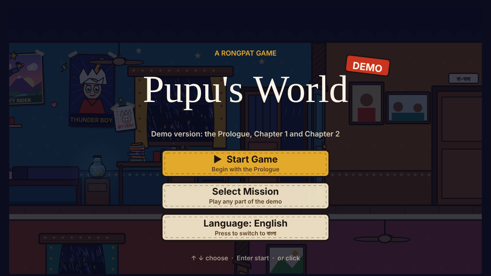

</div>

---

## About

Pupu dreams. Every single night. The people he dislikes come back as enemies; the people he loves come back as friends.
But tonight is different: the memories he locked away are about to open, one by one, and they lead to the one he loves most.

*Pupu's World* is a story-driven 2D platformer set in rural Bangladesh and drawn entirely in code in a **Rongpat** (Bengali folk-art) style: bold ink outlines, flat warm colours, and expressive "fish-eye" faces. Pupu and his ginger cat **Mishti** travel through a dream version of their village, sneaking, jumping, hiding and solving small puzzles, and in every chapter they find one of **Dadu's ten things**, each one unlocking a memory of Pupu's grandfather.

The whole game is a single HTML file: no engine, no images, no downloads. It runs in any modern browser on **PC and phone**, and can be installed as an app.

## Features

- **Hand-drawn in code:** every character, room and animation is drawn on an HTML5 canvas: real walk and run cycles, talking expressions, blinking, weather and lighting.
- **Two languages:** play fully in **English** or fully in **বাংলা**; choose on the start menu.
- **PC and phone:** keyboard controls on PC; on phones, a joystick (push a little to walk, all the way to run) and touch buttons that appear only when needed.
- **Teaches as you play:** a short first-steps tutorial, a goal line above Pupu's head with the buttons to use and an arrow showing the way, glowing objects to interact with, and short tips after a mistake.
- **Stealth, platforming and puzzles:** sneak past Ma at midnight, leap across lotus leaves and flying paper boats, swing on banyan roots, hide from a giant maths teacher whose glasses shine like searchlights, and outrun him across a moonlit schoolyard.
- **Memories with Dadu:** a stone-skipping contest at sunset, and a maths puzzle game at Dadu's table that is different every time you play.
- **Synthesised sound:** all music and sound effects are generated live with the Web Audio API.
- **Installable (PWA):** add it to your home screen and it plays full screen, even offline.

## Screenshots

| | |
|---|---|
| 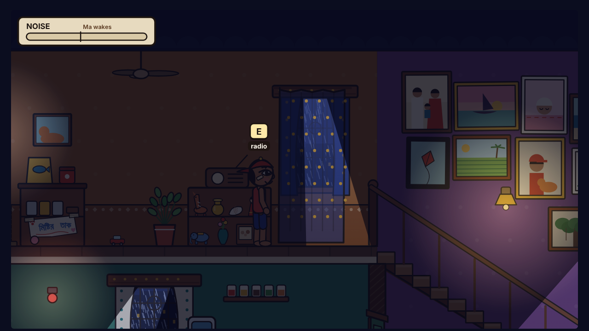 | 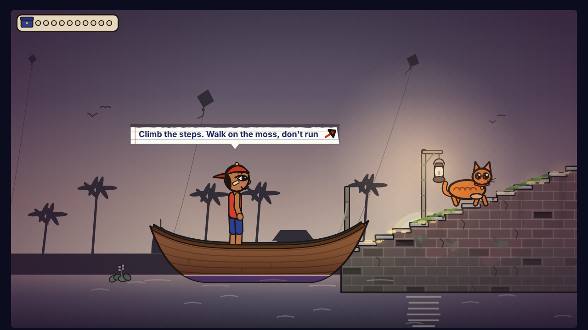 |
| **Prologue · Midnight TV** | **Chapter 1 · The Ghat** |
| 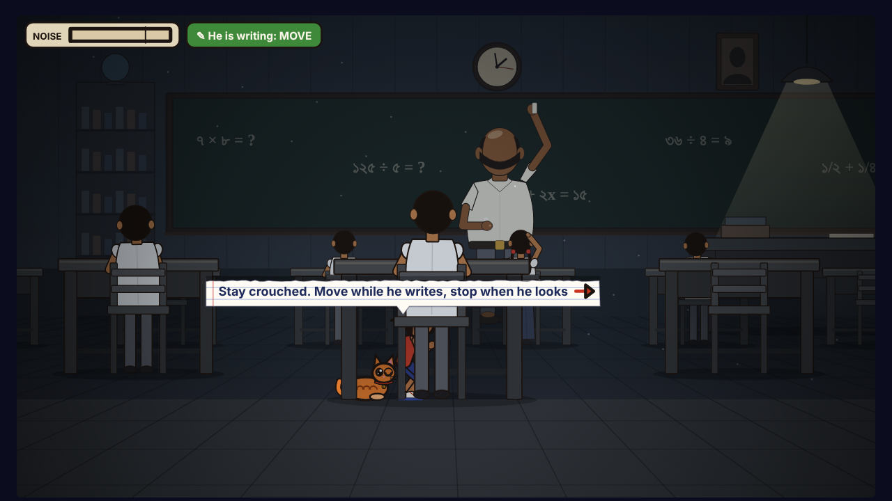 | 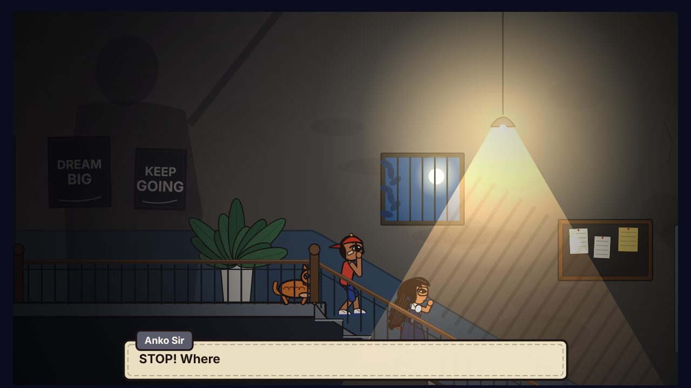 |
| **Chapter 2 · Anko Sir's class** | **Chapter 2 · The stairwell** |
| 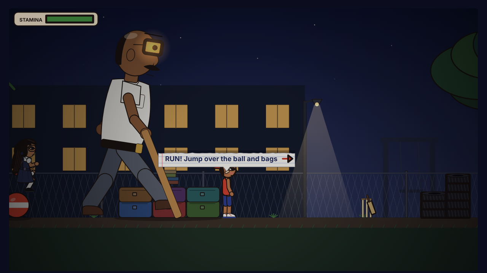 | 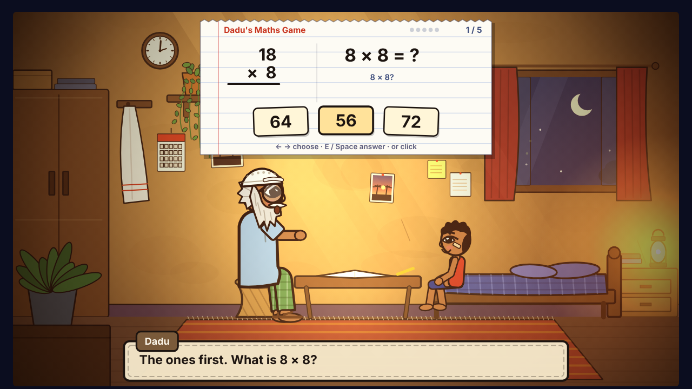 |
| **Chapter 2 · The schoolyard chase** | **Memory · Dadu's maths game** |
| 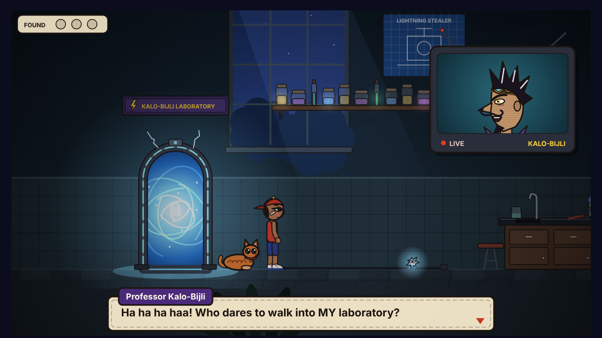 | 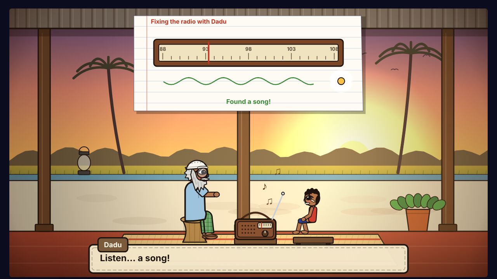 |
| **Chapter 3 · Kalo-Bijli's lab** | **Memory · Fixing the radio with Dadu** |
| 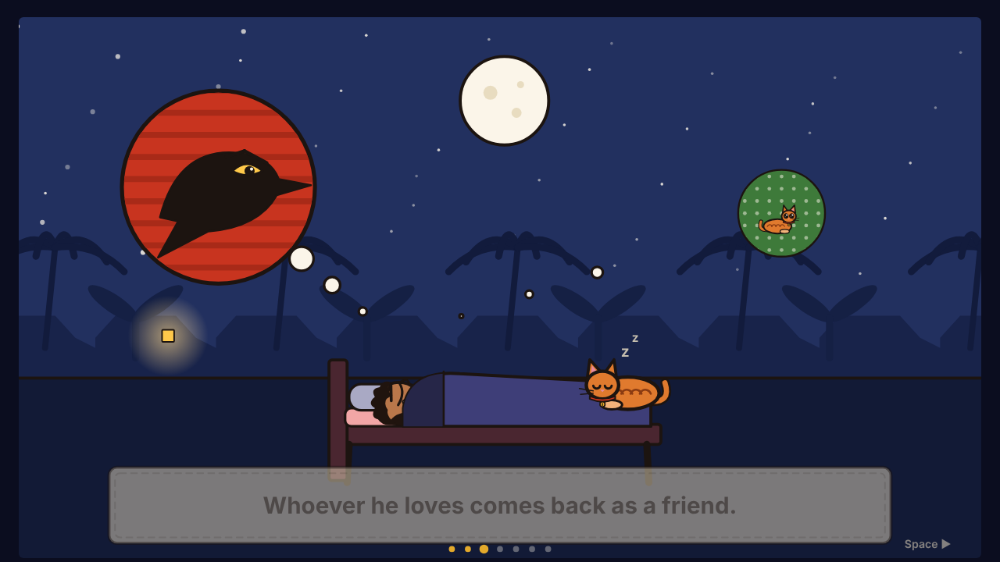 | 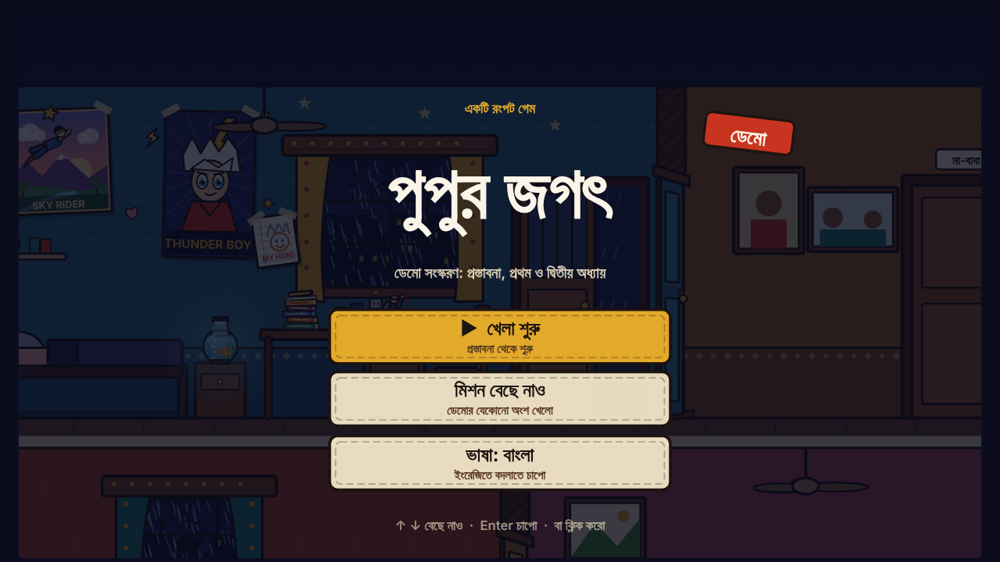 |
| **Story intro** | **Start menu in বাংলা** |

## How to play

| Action | PC | Phone |
|---|---|---|
| Walk | `A` / `D` (or ← →) | Push the joystick a little |
| Run | Hold `Shift` while walking | Push the joystick all the way |
| Jump | `Space` | **JUMP** |
| Crouch / stand | `C` | **SNEAK** |
| Use, hide, sit, pick up | `E` | **USE** (appears when there is something to use) |
| Surprise action (hide, dodge) | `R` | Tap the screen |
| Walk into / out of the room (Chapter 2 only) | `W` / `S` (or ↑ ↓) | Joystick up / down |
| Pause · Mute · Full screen | `P` · `M` · `F` | On-screen buttons |

The game teaches each control the first time it is needed; the pause menu lists them all.

## Chapters (demo)

| Part | Where | What you do |
|---|---|---|
| **Prologue · Midnight TV** | Pupu's house at night | Sneak past Ma to watch the midnight cartoon, feed Mishti, hide when Ma comes out for water. |
| **Chapter 1 · The Ghat** | A dream river ghat at sunset | Climb the old steps, swing on banyan roots, find Dadu's skipping stone, cross lotus leaves and a flying paper boat, outwit a naughty crow. |
| **Chapter 2 · Anko Sir's class** | A giant classroom | Crawl under the benches unseen while the giant maths teacher's glasses sweep the room. |
| **Chapter 2 · The verandah** | The school verandah | Follow Jhumpa and hide whenever a window lights up. |
| **Chapter 2 · The schoolyard** | A moonlit schoolyard | Run, jump, hide behind the big tree, and reach the gate, where Anko Sir has a gift: Dadu's reading glasses. |
| **Chapter 3 · Kalo-Bijli's lab** | The lab of the villain from Pupu's favourite cartoon, through a magic door | Jump his spark-bugs, cross the burners while the flame is low, crouch under live cables, find three glowing parts, reroute his power board, teach Professor Kalo-Bijli a lesson, and fix Dadu's radio with him on the verandah. |

Chapters 4 to 10 and the epilogue in Dadu's room are planned; see [docs/STORY.md](docs/STORY.md).

## Run it yourself

No build step is needed.

```bash
git clone https://github.com/arestadul-max/pupus-world.git
cd pupus-world
# open index.html directly, or serve the folder:
python3 -m http.server 8000   # then visit http://localhost:8000
```

To publish your own copy, enable **GitHub Pages** for the repository (Settings → Pages → Source: *GitHub Actions*); the included workflow deploys the game on every push to `main`.

## Project structure

```
pupus-world/
├── index.html              # the whole game: art, animation, levels, dialogue, sound (HTML5 canvas + JavaScript)
├── manifest.json, sw.js    # install-as-app (PWA) and offline support
├── icons/                  # app icons
├── assets/screenshots/     # images for this README
├── docs/
│   ├── STORY.md            # story, chapters, Dadu's ten things, the epilogue
│   ├── CHARACTERS.md       # the cast: looks, personality, rules
│   ├── ART_BIBLE.md        # the Rongpat visual style and game-feel rules
│   └── BUILD_NOTES.md      # the full design and build log, version by version
└── .github/workflows/pages.yml  # deploys to GitHub Pages
```

## Tech

- Plain **HTML5 Canvas 2D** and vanilla **JavaScript** in one file (about 7,000 lines), no dependencies.
- Characters are drawn procedurally with inverse-kinematics legs and speed-matched walk cycles (no sliding feet).
- **Web Audio API** for all sound; **Google Fonts** (Rozha One, Hind Siliguri) when online.
- Responsive 16:9 stage, letterboxed; touch controls for phones in landscape.

## Credits

Created by **[arestadul-max](https://github.com/arestadul-max)**, story, characters, art direction and game design, built with Claude (Anthropic) as a coding partner.

## License

© 2026 arestadul-max. All rights reserved. See [LICENSE](LICENSE).
